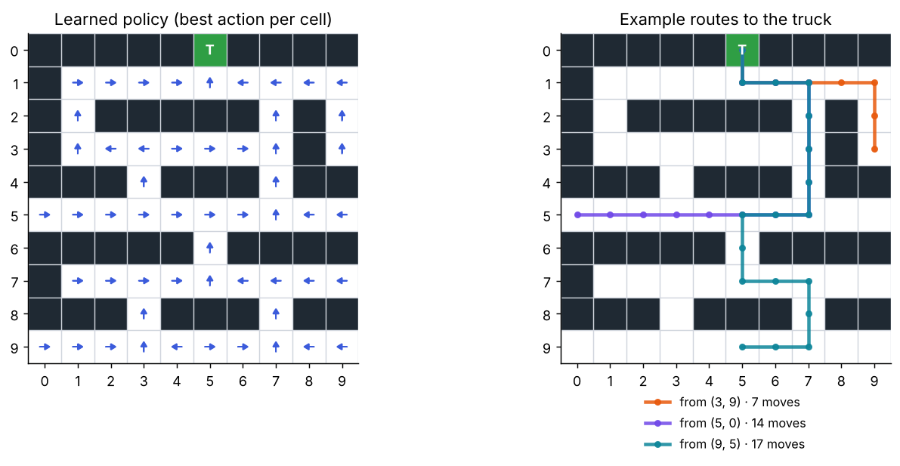
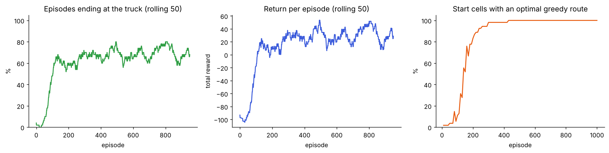
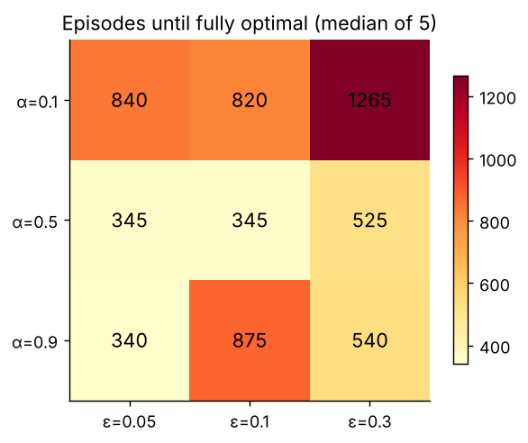

# Autonomous Delivery Drones: Route Planning with Q-Learning

A reinforcement-learning agent that learns to fly packages from any pickup point to a delivery truck **by the shortest route**, without entering no-fly zones. It starts with no map or routing algorithm and learns only from rewards.

  

<p align="center"></p>

## Results

| Metric | Value |
|---|---|
| Start cells where the greedy policy reaches the truck | **54 / 54 (100%)** |
| Start cells where the route equals the BFS shortest path | **54 / 54 (100%)** |
| Episodes until every route is optimal (α = 0.9, ε = 0.1, seed 42) | **430** |
| Longest optimal route in the map | 18 moves |

Optimality is checked, not assumed. Breadth-first search computes the true shortest distance from every corridor cell, and each learned route is compared with it.

<p align="center"></p>

Only about 70% of *training* episodes reach the truck, because ε-greedy exploration keeps making random moves that sometimes hit a no-fly zone. The greedy policy, shown in the right-hand panel, is 100% successful.

## Problem setup

| | |
|---|---|
| **States** | 10 × 10 grid: 54 flight-corridor cells, 45 no-fly cells, 1 delivery truck |
| **Actions** | up, right, down, left |
| **Rewards** | +100 for reaching the truck · −1 per corridor step · −100 for entering a no-fly zone (episode ends) |
| **Update rule** | Q(s,a) ← Q(s,a) + α [ r + γ · maxₐ′ Q(s′,a′) − Q(s,a) ] |
| **Policy** | ε-greedy during training, greedy for evaluation |

## Hyperparameter study

Median number of episodes until **every** start cell follows a shortest route, over 5 seeds:

<p align="center"></p>

- **High learning rates converge 2–3× faster.** The environment is deterministic, so there is no noise for a small α to average out.
- **Heavy exploration (ε = 0.3) slows learning.** Random moves crash most episodes early, so long routes are rarely completed.

## Run it

```bash
git clone https://github.com/vamshiteja999/Autonomous-Delivery-Drones.git
cd Autonomous-Delivery-Drones
pip install -r requirements.txt
jupyter notebook Autonomous_Delivery_Drones_QLearning.ipynb
```

The notebook is seeded and runs end to end in about 40 seconds on a laptop CPU. Most of that time is the hyperparameter study.

## What's in the notebook

1. Environment: reward grid and map
2. Agent helpers: ε-greedy action selection and transitions
3. Training loop with per-episode metrics
4. Learning curves
5. Learned routes, including a reversed route from the truck back out to a pickup point
6. Optimality check against BFS
7. Hyperparameter study (α × ε, 5 seeds each)
8. Conclusions and possible extensions (stochastic wind, battery limits, DQN for larger maps)

## Background

This started as a course project for a reinforcement-learning class, adapting the classic warehouse-robot Q-learning exercise to drone delivery. Later additions: the BFS optimality check, the corrected ε-greedy semantics (the original `exploration_rate = 0.9` actually meant 90% *greedy* moves), terminal-state handling in the update, learning curves, and the hyperparameter study.
